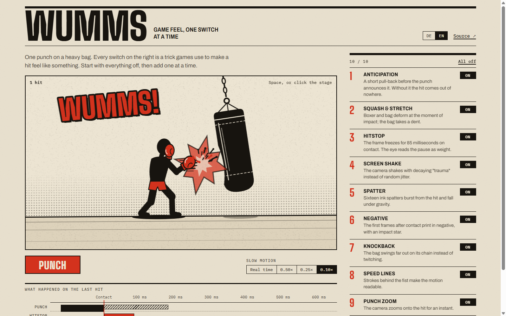

# Wumms

Game feel, one switch at a time. A boxer throws one punch at a heavy bag, and ten switches turn the tricks on and off that make a hit feel like a hit. Drawn like a printed comic: ink on newsprint, one spot colour.

**Live demo:** https://malzinger.github.io/wumms/



## The switches

| Switch           | What it does                                                                     |
| ---------------- | -------------------------------------------------------------------------------- |
| Anticipation     | A 120 ms pull-back before the strike instead of 25 ms                            |
| Squash & stretch | Boxer and bag deform at the moment of impact; the bag takes a dent               |
| Hitstop          | The simulation freezes for 85 ms on contact; the camera keeps shaking            |
| Screen shake     | Trauma-based: offset grows with trauma², trauma decays linearly                  |
| Spatter          | Sixteen ink spatters with gravity and drag                                       |
| Negative         | The first frames after contact print in negative, with an impact star            |
| Knockback        | The bag is a damped spring hanging from a chain; knockback adds angular velocity |
| Speed lines      | Brush strokes trail the fist while the punch is in flight                        |
| Punch zoom       | The camera zooms 6 % onto the impact and eases back                              |
| Sound            | Whoosh and thump synthesized with the Web Audio API, plus the sound lettered     |

Slow motion (0.5×, 0.25×, 0.1×) makes the techniques visible one by one, and a frame timeline shows what happened on the last hit: wind-up, contact, hitstop, how long the shake lasted and when the dummy came to rest.

## Running it

```bash
npm install
npm run dev
```

The simulation (`src/game/sim.ts`) is a pure step function with a fixed 240 Hz step; the renderer draws it on a 2D canvas. `npm test` runs the Vitest suite: contact timing, hitstop freezing time, trauma decay, spring settling and particle lifetime. Switch state lives in the URL, so a specific combination can be linked.

## Stack

React 19, TypeScript (strict), Vite, Vitest, Canvas 2D, Web Audio. Big Shoulders Display, Archivo and IBM Plex Mono are served locally.

## License

MIT © Friedrich Malz
